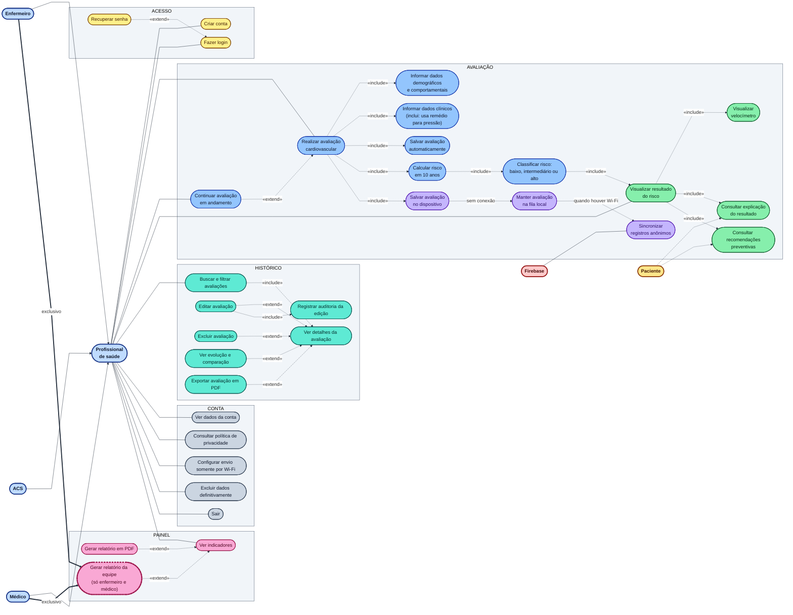

# Diagrama de Caso de Uso — CardioRisco

Este documento apresenta o **diagrama de caso de uso do CardioRisco (Unidade II)**, identificando os atores que interagem com o aplicativo, as funcionalidades disponíveis, organizadas em grupos (Acesso, Avaliação, Histórico, Painel e Conta), e os principais relacionamentos entre elas.

O CardioRisco é uma ferramenta de apoio à avaliação do risco cardiovascular em atendimentos e visitas domiciliares. O sistema reúne informações demográficas, comportamentais e clínicas, calcula o risco de ocorrência de um evento cardiovascular nos próximos 10 anos e apresenta o resultado de forma visual e educativa. Na Unidade II, o aplicativo passou a contar com autenticação, histórico de avaliações, painel de indicadores e gerenciamento de conta.

---

## 1. Diagrama

**Legenda de cores:** amarelo = Acesso · azul e verde = Avaliação (azul: preenchimento e cálculo; verde: resultado) · roxo = armazenamento e sincronização · turquesa = Histórico · rosa = Painel · cinza = Conta · azul-escuro (negrito) = atores · âmbar = paciente · vermelho-claro = serviço externo.

**Como ler o diagrama:**
- Linhas contínuas ligam atores a casos de uso; setas tracejadas ligam casos de uso entre si (`«include»`, `«extend»` ou condição).
- `ACS`, `Enfermeiro` e `Médico` são especializações do ator geral **Profissional de saúde** (setas para ele). Tudo o que está ligado ao Profissional de saúde pode ser feito pelos três.
- **Controle de acesso:** "Gerar relatório da equipe" (borda tracejada) está ligado **apenas** ao Enfermeiro e ao Médico, pelas linhas grossas rotuladas "exclusivo". O ACS não tem ligação com ele.
- Nas áreas Histórico e Painel, o profissional se liga ao caso de uso de entrada ("Buscar e filtrar avaliações" e "Ver indicadores"); as demais ações (editar, excluir, evolução, exportar, relatórios) partem dele por `«extend»`.
- O Mermaid não possui notação UML nativa de caso de uso; por isso, usa-se `flowchart`.
- "Fazer login" não é ligado a todos os casos de uso: é pré-condição para as funcionalidades dos profissionais.

---

## 2. Descrição dos atores

| Ator | O que representa | Principais responsabilidades | Restrições de acesso |
|---|---|---|---|
| `Profissional de saúde` | Ator geral (generalização de ACS, Enfermeiro e Médico) | Funcionalidades comuns aos três: acesso, avaliação, histórico, indicadores, relatório em PDF e conta | Não inclui o relatório da equipe |
| `ACS` | Agente Comunitário de Saúde | Criar conta e fazer login, realizar avaliações em visitas domiciliares, consultar o histórico e os indicadores, gerar relatórios individuais, gerenciar a conta | **Não** pode gerar o relatório da equipe |
| `Enfermeiro` | Profissional de enfermagem da atenção básica | Mesmas responsabilidades do ACS, além de gerar o **relatório da equipe** | Acesso completo às funcionalidades do profissional |
| `Médico` | Médico da atenção básica | Mesmas responsabilidades do ACS, além de gerar o **relatório da equipe** e consultar resultados como apoio à análise clínica, orientação ou encaminhamento | Acesso completo às funcionalidades do profissional |
| `Paciente` | Pessoa que está sendo avaliada | Participar da avaliação sob supervisão e compreender o significado do resultado apresentado (explicação e recomendações) | Não opera o sistema; não faz login |
| `Firebase` | Serviço externo de armazenamento | Receber os registros anônimos enviados pelo aplicativo quando houver conexão Wi-Fi | Recebe apenas registros anônimos |

### 2.1 Matriz de acesso por área

| Área | Caso de uso | ACS | Enfermeiro | Médico | Paciente |
|---|---|:---:|:---:|:---:|:---:|
| Acesso | Criar conta, fazer login, recuperar senha | ✔ | ✔ | ✔ | — |
| Avaliação | Realizar e continuar avaliação | ✔ | ✔ | ✔ | — |
| Avaliação | Visualizar resultado e velocímetro | ✔ | ✔ | ✔ | — |
| Avaliação | Consultar explicação e recomendações | ✔ | ✔ | ✔ | ✔ (sob supervisão) |
| Histórico | Buscar, filtrar, ver detalhes, editar, excluir, evolução, exportar PDF | ✔ | ✔ | ✔ | — |
| Painel | Ver indicadores e gerar relatório em PDF | ✔ | ✔ | ✔ | — |
| Painel | **Gerar relatório da equipe** | ✘ | ✔ | ✔ | — |
| Conta | Ver dados, política de privacidade, envio por Wi-Fi, excluir dados, sair | ✔ | ✔ | ✔ | — |

---

## 3. Descrição dos casos de uso

### 3.1 Acesso

| Caso de uso | O que representa | Principais responsabilidades |
|---|---|---|
| `Criar conta` | Cadastro do profissional | Permitir que o profissional crie seu acesso ao aplicativo |
| `Fazer login` | Autenticação | Identificar o profissional para liberar as funcionalidades do aplicativo |
| `Recuperar senha` | Recuperação de acesso | Permitir a redefinição da senha quando o profissional não conseguir entrar |

### 3.2 Avaliação

| Caso de uso | O que representa | Principais responsabilidades |
|---|---|---|
| `Realizar avaliação cardiovascular` | Processo principal do aplicativo | Iniciar e conduzir o preenchimento das informações necessárias para avaliar o risco |
| `Informar dados demográficos e comportamentais` | Primeira parte dos dados da avaliação | Registrar idade, sexo, tabagismo e diabetes |
| `Informar dados clínicos` | Informações clínicas do paciente | Registrar pressão arterial sistólica, colesterol total, HDL e se o paciente **usa remédio para pressão** |
| `Continuar avaliação em andamento` | Retomada de avaliação não concluída | Reabrir uma avaliação interrompida com os dados já preenchidos |
| `Salvar avaliação automaticamente` | Salvamento automático do rascunho | Guardar o preenchimento durante a avaliação, evitando perda de dados |
| `Calcular risco cardiovascular em 10 anos` | Processamento dos dados informados | Calcular a probabilidade de ocorrência de um evento cardiovascular nos próximos 10 anos |
| `Classificar risco` | Interpretação do resultado calculado | Classificar o resultado em risco baixo, intermediário ou alto |
| `Visualizar resultado do risco` | Apresentação da avaliação | Exibir o percentual e a classificação obtidos |
| `Visualizar velocímetro de risco` | Representação visual obrigatória | Apresentar o risco por meio de um velocímetro com ponteiro |
| `Consultar explicação do resultado` | Apoio à compreensão do paciente | Apresentar o significado do resultado em linguagem simples |
| `Consultar recomendações preventivas` | Orientações relacionadas ao resultado | Apresentar orientações sobre hábitos de vida e possível necessidade de encaminhamento |
| `Salvar avaliação no dispositivo` | Persistência local dos dados | Guardar a avaliação no próprio aparelho, inclusive quando não houver internet |
| `Manter avaliação na fila local` | Controle de avaliações ainda não enviadas | Preservar os registros até que exista conexão Wi-Fi disponível |
| `Sincronizar registros anônimos` | Envio dos dados ao serviço remoto | Enviar os registros anônimos ao Firebase quando o dispositivo estiver conectado a uma rede Wi-Fi |

### 3.3 Histórico

| Caso de uso | O que representa | Principais responsabilidades |
|---|---|---|
| `Buscar e filtrar avaliações` | Consulta ao histórico | Localizar avaliações por busca e por filtros |
| `Ver detalhes da avaliação` | Consulta individual | Exibir os dados e o resultado de uma avaliação registrada |
| `Editar avaliação` | Correção de registros | Alterar uma avaliação já salva e recalcular o resultado |
| `Registrar auditoria da edição` | Rastreabilidade | Registrar a edição feita (o que mudou, quando e por quem) |
| `Excluir avaliação` | Remoção de registro | Remover uma avaliação do histórico |
| `Ver evolução e comparação` | Acompanhamento ao longo do tempo | Comparar avaliações e mostrar a evolução do risco |
| `Exportar avaliação em PDF` | Exportação do histórico | Gerar um PDF a partir de avaliações do histórico |

### 3.4 Painel

| Caso de uso | O que representa | Principais responsabilidades |
|---|---|---|
| `Ver indicadores` | Visão consolidada | Exibir indicadores gerais das avaliações realizadas |
| `Gerar relatório em PDF` | Relatório do profissional | Gerar um relatório em PDF com os indicadores |
| `Gerar relatório da equipe` | Relatório consolidado da equipe | Gerar relatório da equipe; **disponível somente para enfermeiro e médico** |

### 3.5 Conta

| Caso de uso | O que representa | Principais responsabilidades |
|---|---|---|
| `Ver dados da conta` | Consulta ao perfil | Exibir os dados do profissional autenticado |
| `Consultar política de privacidade` | Transparência | Apresentar como os dados são tratados |
| `Configurar envio somente por Wi-Fi` | Controle de sincronização | Restringir o envio dos registros anônimos ao Firebase a redes Wi-Fi |
| `Excluir dados definitivamente` | Direito de remoção | Apagar de forma definitiva os dados da conta |
| `Sair` | Encerramento de sessão | Encerrar a sessão do profissional |

---

## 4. Relacionamentos

**Acesso**
- **Profissionais → Criar conta / Fazer login:** o ACS, o enfermeiro e o médico se cadastram e se autenticam para usar o aplicativo.
- **Recuperar senha → Fazer login:** a recuperação de senha estende o login, sendo usada quando o profissional não consegue entrar.

**Avaliação**
- **Profissionais → Realizar avaliação cardiovascular:** o ACS, o enfermeiro e o médico podem conduzir avaliações.
- **Profissionais → Continuar avaliação em andamento:** o profissional retoma uma avaliação interrompida; esse caso de uso estende a avaliação principal.
- **Realizar avaliação → Informar dados:** a avaliação depende do preenchimento dos dados demográficos, comportamentais e clínicos (incluindo o uso de remédio para pressão).
- **Realizar avaliação → Salvar automaticamente:** o preenchimento é salvo automaticamente durante a avaliação.
- **Calcular risco → Classificar risco:** após o cálculo, o sistema apresenta uma classificação do risco cardiovascular.
- **Resultado → Velocímetro, explicação e recomendações:** o resultado é apresentado visualmente e acompanhado de explicação e orientações compreensíveis.
- **Paciente → Explicação e recomendações:** o paciente tem contato com o resultado sob supervisão do profissional.
- **Avaliação → Armazenamento local:** os dados são salvos no dispositivo para que a ausência de internet não impeça a avaliação.
- **Fila local → Firebase:** quando houver Wi-Fi, os registros anônimos são sincronizados com o Firebase.

**Histórico**
- **Buscar e filtrar → Ver detalhes:** a partir da lista filtrada, o profissional abre uma avaliação.
- **Ver detalhes → Editar, Excluir, Ver evolução e comparação, Exportar PDF:** são ações que partem da avaliação aberta.
- **Editar → Registrar auditoria:** toda edição gera obrigatoriamente um registro de auditoria.

**Painel**
- **Ver indicadores → Gerar relatório em PDF:** o relatório é gerado a partir dos indicadores exibidos.
- **Enfermeiro e Médico → Gerar relatório da equipe:** controle de acesso; o ACS não tem esta funcionalidade.

**Conta**
- **Configurar envio somente por Wi-Fi → Sincronizar registros:** a configuração condiciona a sincronização com o Firebase.
- **Profissionais → Excluir dados definitivamente / Sair:** o profissional controla seus dados e encerra a sessão.

---

## 5. Regras de negócio representadas

**Acesso e utilização**
- O aplicativo é destinado principalmente a profissionais da atenção básica, como ACS, enfermeiros e médicos.
- O profissional deve criar uma conta e fazer login para utilizar o aplicativo, podendo recuperar a senha quando necessário.
- O paciente não é o operador principal do sistema; sua participação ocorre sob supervisão do profissional.
- O aplicativo funciona como ferramenta de apoio e não substitui a avaliação médica.
- O relatório da equipe só pode ser gerado por enfermeiros e médicos.

**Avaliação cardiovascular**
- O formulário reúne dados demográficos, comportamentais e clínicos.
- Os dados incluem idade, sexo, tabagismo, diabetes, pressão arterial sistólica, colesterol total, HDL e uso de remédio para pressão.
- A avaliação é salva automaticamente e pode ser continuada caso seja interrompida.
- O cálculo estima o risco de ocorrência de um evento cardiovascular nos próximos 10 anos.
- O resultado deve ser classificado como baixo, intermediário ou alto.

**Apresentação do resultado**
- A tela de resultado deve apresentar um velocímetro com ponteiro.
- O resultado deve ser acompanhado de explicações em linguagem simples.
- O aplicativo deve apresentar recomendações relacionadas ao nível de risco identificado, incluindo orientações de estilo de vida ou indicação de encaminhamento.
- O resultado deve ser apresentado imediatamente após a avaliação.

**Histórico e painel**
- O histórico permite buscar, filtrar e abrir os detalhes das avaliações.
- Toda edição de avaliação deve gerar registro de auditoria.
- O profissional pode excluir avaliações, visualizar a evolução e a comparação entre avaliações e exportar em PDF.
- O painel apresenta indicadores e permite gerar relatório em PDF.

**Funcionamento offline e sincronização**
- A avaliação deve poder ser realizada sem conexão com a internet.
- Os dados devem permanecer armazenados localmente até que seja possível sincronizá-los.
- A sincronização com o Firebase deve ocorrer quando houver Wi-Fi.
- O envio ocorre somente por Wi-Fi, conforme a configuração da conta.

**Privacidade**
- Os registros enviados ao armazenamento remoto devem ser anônimos.
- O histórico não deve armazenar nome ou CPF do paciente.
- Quando necessário, devem ser utilizados apelidos ou códigos internos para identificar os registros.
- O profissional pode consultar a política de privacidade e excluir seus dados definitivamente.

**Restrições de interface e fluxo**
- O formulário não deve ultrapassar sete perguntas.
- O fluxo principal deve exigir até três interações principais: abrir o aplicativo, preencher os dados e tocar em "Avaliar Risco".

---

## 6. Relação com outros documentos

- O **Estudo de Caso — CardioRisco** apresenta o problema, os usuários, o contexto de utilização, as funcionalidades e as restrições do aplicativo.
- O **Protótipo de Alta Fidelidade — Unidade II** representa visualmente as telas e o fluxo de utilização do aplicativo.
- O **Diagrama de Classes — CardioRisco** detalha os modelos de domínio, seus atributos, métodos e relacionamentos.
- O documento de modelagem do banco de dados descreve como os dados são organizados e armazenados localmente e no Firebase.

O diagrama de caso de uso complementa esses documentos ao apresentar, de forma visual, **quem utiliza o CardioRisco e quais funcionalidades o sistema oferece**.
