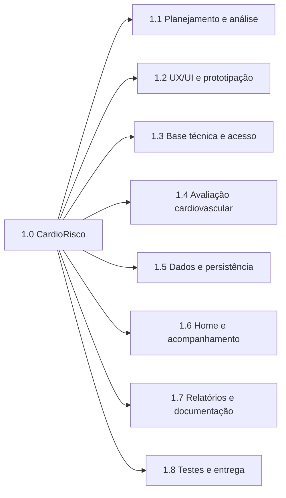

# CardioRisco — Planejamento do Projeto

> *"A régua digital que mede o futuro do coração do paciente."*

**Aplicativo de Avaliação do Risco Cardiovascular** · Escopo do projeto · EAP simplificada · Planejamento em sprints

| 4 | 8 | 8 | 3 |
|:---:|:---:|:---:|:---:|
| sprints | semanas | pacotes da EAP | integrantes |

**Tecnologias:** Flutter · Dart · Firebase Auth · Cloud Firestore · Offline-first

### Equipe

| Integrante | Foco |
|---|---|
| José Victor | Avaliação e cálculo |
| João Gabriel | Arquitetura e dados |
| Erick Gabriel | Histórico e relatórios |

---

# Parte 1 — Escopo do Projeto

*Identificação, funcionalidades, restrições e entregáveis*

Com base nas funcionalidades, nos requisitos funcionais e não funcionais, nas personas e no estudo de caso do CardioRisco, o grupo elaborou o planejamento do projeto dividido em três partes: escopo do projeto, Estrutura Analítica do Projeto (EAP) simplificada e planejamento do desenvolvimento em sprints.

## 1. Identificação do projeto

**Nome:** CardioRisco — Aplicativo de Avaliação do Risco Cardiovascular.

**Proposta:** Desenvolver um aplicativo mobile utilizando Flutter e Dart para auxiliar profissionais da atenção básica na avaliação do risco cardiovascular de pacientes, apresentando o resultado de forma visual e educativa.

## 2. Objetivo geral

Disponibilizar uma ferramenta ágil para que Agentes Comunitários de Saúde (ACS), enfermeiros e médicos registrem informações demográficas, comportamentais e clínicas dos pacientes, obtenham uma estimativa do risco cardiovascular nos próximos 10 anos e consigam explicar o resultado de maneira simples.

O aplicativo deverá apoiar a prevenção e a tomada de decisões dos profissionais de saúde, sem substituir diagnósticos ou avaliações clínicas.

## 3. Escopo funcional — funcionalidades incluídas

O projeto contemplará as seguintes funcionalidades:

| # | Funcionalidade | Descrição |
|:---:|---|---|
| 1 | **Coleta de dados** | Formulário para informar idade, sexo, tabagismo, diabetes, pressão arterial sistólica, colesterol total e HDL. |
| 2 | **Validação dos dados** | Verificação dos campos obrigatórios e identificação de valores inválidos. |
| 3 | **Cálculo cardiovascular** | Estimativa percentual do risco de ocorrência de eventos cardiovasculares nos próximos 10 anos. |
| 4 | **Classificação do risco** | Apresentação dos níveis baixo, intermediário e alto. |
| 5 | **Visualização gráfica** | Apresentação do resultado por meio de um velocímetro com ponteiro. |
| 6 | **Recomendações** | Orientações preventivas conforme o resultado obtido. |
| 7 | **Funcionamento offline** | Realização das avaliações sem necessidade de conexão com a internet. |
| 8 | **Armazenamento local** | Manutenção temporária dos registros no dispositivo. |
| 9 | **Sincronização** | Envio dos registros anônimos ao Firebase quando houver conexão. |
| 10 | **Gerenciamento de avaliações** | Criação, consulta, atualização e exclusão dos registros, respeitando as regras de privacidade. |
| 11 | **Recursos complementares** | Autenticação, cadastro do profissional, tela inicial, histórico de avaliações, comparação de resultados, dashboard e relatórios, conforme a priorização do grupo. |

## 4. Escopo técnico

- Desenvolvimento mobile utilizando Flutter e Dart.
- Arquitetura organizada em camadas: Presentation, Domain e Data.
- Firebase Authentication para autenticação dos profissionais.
- Cloud Firestore para armazenamento remoto.
- Persistência local para funcionamento offline.
- Sincronização automática dos registros quando houver internet.
- Interface com alto contraste e preferência pelo modo escuro.
- Compatibilidade com smartphones de resolução HD (720p).
- Otimização para aparelhos com aproximadamente 2 GB a 4 GB de RAM.

## 5. Restrições e requisitos de qualidade

O desenvolvimento deverá respeitar as seguintes condições:

- No máximo quatro telas principais no fluxo de avaliação.
- Formulário com até sete perguntas.
- Resultado apresentado imediatamente após a avaliação.
- Funcionamento da avaliação independente da internet.
- Não armazenar nome ou CPF do paciente.
- Utilizar códigos internos ou identificadores anônimos quando necessário.
- Permitir exclusão definitiva dos dados conforme a política de privacidade.
- Evitar bibliotecas gráficas pesadas.
- Manter o APK otimizado para dispositivos básicos.

## 6. Limites do projeto

O CardioRisco não realiza diagnósticos médicos, não substitui consultas ou decisões dos profissionais de saúde e não é destinado ao atendimento de emergências cardiovasculares.

Sua finalidade é auxiliar na avaliação preventiva e na comunicação do risco cardiovascular.

## 7. Entregáveis do projeto

- Protótipos de baixa e alta fidelidade.
- Aplicativo mobile desenvolvido em Flutter.
- Módulo de avaliação cardiovascular.
- Classificação e velocímetro de risco.
- Módulo de recomendações.
- Sistema de armazenamento local.
- Integração com Firebase.
- Histórico e gerenciamento de avaliações.
- Testes funcionais.
- APK instalável.
- Documentação e diagramas do projeto.

## 8. Critérios de aceitação

O projeto será considerado funcional quando:

- [x] O profissional conseguir preencher os dados e realizar uma avaliação.
- [x] O sistema validar corretamente os campos obrigatórios.
- [x] O cálculo apresentar um percentual e uma classificação de risco.
- [x] O velocímetro representar visualmente o resultado.
- [x] As recomendações forem apresentadas conforme a classificação.
- [x] A avaliação funcionar sem conexão com a internet.
- [x] Os registros offline forem preservados e sincronizados posteriormente.
- [x] Os dados respeitarem as regras de anonimização.
- [x] A interface funcionar adequadamente nos dispositivos definidos pelo estudo de caso.

## 9. Responsáveis do grupo

| Integrante | Responsabilidades |
|---|---|
| **José Victor** | Avaliação cardiovascular, formulário, validações clínicas, cálculo, tema visual, velocímetro, recomendações e testes do cálculo. |
| **João Gabriel** | Estrutura técnica, arquitetura, autenticação, Firebase, armazenamento local, sincronização, privacidade e geração do APK. |
| **Erick Gabriel** | Home, histórico, comparação e evolução das avaliações, dashboard, relatórios e documentação do planejamento. |

---

# Parte 2 — Estrutura Analítica do Projeto

*EAP simplificada em oito grandes grupos de trabalho*

A EAP organiza o projeto em etapas e entregas menores, facilitando a divisão das atividades e o acompanhamento do desenvolvimento. Para o CardioRisco, a estrutura será dividida em oito grandes grupos de trabalho.

## 1.0 CardioRisco

*Aplicativo de avaliação do risco cardiovascular*

### 1.1 Planejamento e análise

- Definição do escopo.
- Levantamento dos requisitos funcionais e não funcionais.
- Identificação das personas.
- Priorização das funcionalidades.
- Divisão das responsabilidades.

### 1.2 UX/UI e prototipação

- Definição da identidade visual.
- Escolha das cores, fontes e tema.
- Desenvolvimento dos protótipos de baixa e alta fidelidade.
- Construção das quatro telas principais.
- Definição do fluxo de navegação.

### 1.3 Base técnica e acesso

- Configuração do projeto Flutter e Dart.
- Organização da arquitetura em camadas.
- Implementação do gerenciamento de estado.
- Desenvolvimento da autenticação.
- Configuração dos perfis e controle de acesso.

### 1.4 Avaliação cardiovascular

- Desenvolvimento dos formulários.
- Implementação do salvamento automático.
- Validação dos dados.
- Implementação do cálculo cardiovascular.
- Desenvolvimento dos testes automatizados.
- Classificação do risco.
- Implementação do velocímetro.
- Desenvolvimento das recomendações.

### 1.5 Dados e persistência

- Implementação dos códigos anônimos.
- Desenvolvimento das operações CRUD.
- Armazenamento local.
- Criação da fila offline.
- Integração com Firestore.
- Sincronização dos registros.
- Implementação das regras de privacidade e exclusão.

### 1.6 Home e acompanhamento

- Desenvolvimento da tela inicial.
- Implementação do histórico.
- Consulta, edição e exclusão de avaliações.
- Comparação entre avaliações.
- Gráficos de evolução.
- Desenvolvimento do dashboard.

### 1.7 Relatórios e documentação

- Desenvolvimento de relatórios em PDF.
- Organização dos diagramas.
- Documentação da modelagem.
- Atualização do README.
- Atualização do CHANGELOG.
- Registro do uso de inteligência artificial.
- Justificativa das bibliotecas utilizadas.

### 1.8 Testes e entrega

- Testes integrados.
- Testes de funcionamento offline.
- Testes de compatibilidade com resolução 720p.
- Testes em smartphones básicos.
- Correção de erros.
- Geração do APK.
- Preparação da apresentação e defesa do projeto.

## Responsáveis por pacote de trabalho

| Integrante | Responsabilidades |
|---|---|
| **José Victor** | Identidade visual, protótipo de alta fidelidade, formulário, validações clínicas, cálculo, velocímetro, recomendações e testes do cálculo. |
| **João Gabriel** | Estrutura Flutter, arquitetura, autenticação, Firebase, armazenamento local, sincronização, privacidade e geração do APK. |
| **Erick Gabriel** | Fluxo de navegação, home, histórico, comparação, evolução, dashboard, relatórios e documentação do planejamento. |
| **Todos** | Integração entre módulos, commits individuais, documentação das entregas, testes finais e apresentação. |

A EAP representa a divisão do trabalho em entregas menores. Algumas atividades poderão acontecer simultaneamente, desde que as responsabilidades e a integração entre os módulos sejam previamente combinadas.

---

# Parte 3 — Planejamento em Sprints

*Organização ágil inspirada no Scrum · 4 sprints · 8 semanas*

O grupo utilizará uma organização ágil inspirada na metodologia Scrum, dividindo o desenvolvimento em quatro sprints. Cada sprint terá duração sugerida de duas semanas, totalizando oito semanas de desenvolvimento. Ao final de cada ciclo, deverá existir uma entrega funcional para avaliação do grupo.

## Resumo do cronograma

| Sprint | Foco | Sem 1 | Sem 2 | Sem 3 | Sem 4 | Sem 5 | Sem 6 | Sem 7 | Sem 8 |
|---|---|:---:|:---:|:---:|:---:|:---:|:---:|:---:|:---:|
| **Sprint 1** | Planejamento e protótipo | ■ | ■ | | | | | | |
| **Sprint 2** | Formulários e cálculo | | | ■ | ■ | | | | |
| **Sprint 3** | Firebase, histórico e CRUD | | | | | ■ | ■ | | |
| **Sprint 4** | Dashboard, testes e entrega | | | | | | | ■ | ■ |

## Sprint 1 — Semanas 1 e 2

**Planejamento, prototipação e base do projeto**

**Objetivo:** Estruturar o projeto e preparar a interface que será utilizada no desenvolvimento.

**Atividades**

- Revisar o estudo de caso, as personas e os requisitos.
- Definir o escopo, a EAP e as prioridades.
- Estabelecer a arquitetura e o modelo de dados.
- Criar os protótipos de baixa e alta fidelidade.
- Definir a identidade visual.
- Configurar o ambiente Flutter e Dart.
- Organizar o repositório GitHub.

**Responsabilidades**

- **José Victor** — identidade visual e protótipos de alta fidelidade.
- **João Gabriel** — estrutura inicial, arquitetura e autenticação.
- **Erick Gabriel** — fluxo de navegação, escopo, EAP e planejamento das sprints.

**Entregas esperadas**

- [x] Protótipos e diagramas revisados.
- [x] Projeto-base configurado.
- [x] Arquitetura definida.
- [x] Responsabilidades organizadas.

## Sprint 2 — Semanas 3 e 4

**Formulário e avaliação cardiovascular**

**Objetivo:** Implementar o processo principal de avaliação cardiovascular.

**Atividades**

- Desenvolver o formulário demográfico e comportamental.
- Desenvolver o formulário de dados clínicos.
- Implementar o salvamento automático.
- Implementar a validação dos campos.
- Desenvolver o cálculo do risco cardiovascular.
- Criar testes automatizados do cálculo.
- Implementar a classificação do risco.
- Desenvolver o velocímetro e as recomendações.
- Implementar a persistência local necessária para a avaliação offline.

**Responsabilidades**

- **José Victor** — formulário, validações, cálculo, testes, velocímetro e recomendações.
- **João Gabriel** — persistência local e estrutura para salvar as avaliações.
- **Erick Gabriel** — integração do fluxo inicial e preparação da estrutura do histórico.

**Entregas esperadas**

- [x] Formulários funcionais.
- [x] Cálculo cardiovascular implementado.
- [x] Resultado com percentual e classificação.
- [x] Velocímetro funcionando.
- [x] Primeira versão funcional do aplicativo.

## Sprint 3 — Semanas 5 e 6

**Dados, histórico e sincronização**

**Objetivo:** Desenvolver o armazenamento, o gerenciamento das avaliações e a integração com Firebase.

**Atividades**

- Implementar cadastro e login dos profissionais.
- Configurar Firebase Authentication.
- Configurar Cloud Firestore.
- Implementar códigos anônimos dos pacientes.
- Desenvolver a fila de armazenamento offline.
- Implementar sincronização automática.
- Evitar duplicidade de registros durante a sincronização.
- Desenvolver a tela inicial e o histórico.
- Implementar consulta, edição e exclusão das avaliações.
- Desenvolver comparação entre avaliações e gráficos de evolução.

**Responsabilidades**

- **José Victor** — ajustes no formulário, modo de edição e correções na avaliação.
- **João Gabriel** — Firebase, autenticação, armazenamento, sincronização, privacidade e exclusão dos registros.
- **Erick Gabriel** — home, histórico, consulta, edição, exclusão, comparação e evolução das avaliações.

**Entregas esperadas**

- [x] Autenticação funcionando.
- [x] Integração com Firebase.
- [x] Histórico de avaliações.
- [x] Operações CRUD.
- [x] Sincronização funcionando com e sem internet.

## Sprint 4 — Semanas 7 e 8

**Dashboard, integração, testes e entrega final**

**Objetivo:** Integrar os módulos, testar o aplicativo e preparar a versão final.

**Atividades**

- Integrar todos os módulos.
- Desenvolver o dashboard do ACS.
- Implementar gráficos e relatórios em PDF, conforme prioridade.
- Testar o funcionamento offline.
- Testar a sincronização dos registros.
- Verificar permissões e privacidade.
- Testar a compatibilidade com resolução HD de 720p.
- Avaliar o desempenho em smartphones básicos.
- Corrigir falhas identificadas.
- Gerar o APK final.
- Atualizar README e CHANGELOG.
- Preparar a apresentação e defesa oral.

**Responsabilidades**

- **José Victor** — revisão clínica e visual, testes do cálculo e correções.
- **João Gabriel** — integração final, segurança, sincronização, geração do APK e testes em dispositivos básicos.
- **Erick Gabriel** — dashboard, relatórios priorizados e documentação do planejamento.
- **Todos** — testes integrados, revisão do código e preparação da apresentação.

**Entregas esperadas**

- [x] Aplicativo integrado e testado.
- [x] Dashboard e relatórios priorizados.
- [x] Sincronização funcionando.
- [x] APK final.
- [x] Documentação atualizada.
- [x] Apresentação preparada.

---

## Rotina de acompanhamento

Durante o desenvolvimento, o grupo deverá realizar:

| # | Prática | Descrição |
|:---:|---|---|
| 1 | **Planejamento** | Definir as tarefas e os responsáveis no início de cada sprint. |
| 2 | **Checkpoint semanal** | Acompanhar o progresso e identificar dificuldades. |
| 3 | **Revisão** | Demonstrar as funcionalidades desenvolvidas ao final de cada sprint. |
| 4 | **Retrospectiva** | Identificar melhorias para o próximo ciclo. |
| 5 | **Controle de versão** | Cada integrante deverá realizar seus commits utilizando sua própria conta no GitHub. |
| 6 | **Documentação** | Atualizar README, CHANGELOG e registros de utilização de inteligência artificial conforme as atividades realizadas. |

## Prioridades e dependências

- As funcionalidades essenciais deverão ser concluídas antes das funcionalidades complementares.
- O cálculo cardiovascular e seus critérios clínicos precisam ser definidos e validados antes da homologação dos resultados.
- A estrutura do banco de dados deverá ser combinada antes da integração entre os módulos. O histórico dependerá da implementação do formulário e do modelo de avaliações.
- Recursos como relatórios epidemiológicos agregados e exportação em PDF poderão ser adiados caso comprometam a conclusão das funcionalidades principais.

---

## Considerações finais

**Um aplicativo funcional, acessível e confiável.**

O planejamento proposto permite desenvolver o CardioRisco de maneira organizada e progressiva, priorizando inicialmente as funcionalidades essenciais e posteriormente os recursos complementares.

A divisão em quatro sprints possibilita acompanhar a evolução do aplicativo, identificar problemas antecipadamente e realizar ajustes durante o desenvolvimento. A distribuição das responsabilidades entre José Victor, João Gabriel e Erick Gabriel busca organizar o trabalho de acordo com os módulos do sistema, facilitando a integração e evitando a concentração das atividades em apenas um integrante.

O resultado esperado é um aplicativo funcional, acessível e confiável, capaz de auxiliar profissionais da atenção básica na avaliação preventiva do risco cardiovascular, facilitando a interpretação dos resultados e a comunicação com os pacientes.
