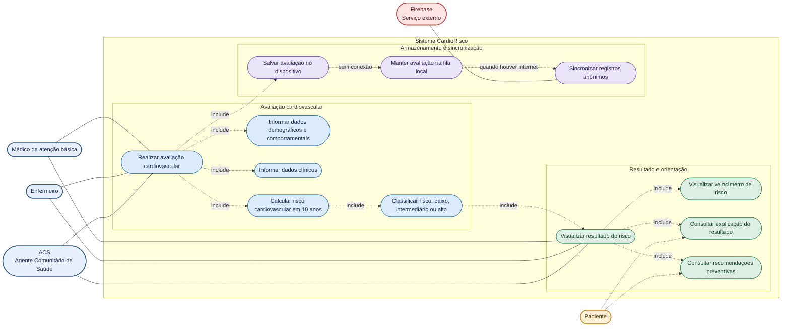

# Diagrama de Caso de Uso — CardioRisco

Este documento apresenta o **diagrama de caso de uso do CardioRisco**, identificando os atores que interagem com o aplicativo, as funcionalidades disponíveis e os principais relacionamentos entre essas funcionalidades.

O CardioRisco é uma ferramenta de apoio à avaliação do risco cardiovascular em atendimentos e visitas domiciliares. O sistema reúne informações demográficas, comportamentais e clínicas, calcula o risco de ocorrência de um evento cardiovascular nos próximos 10 anos e apresenta o resultado de forma visual e educativa.

---

## 1. Diagrama

**Observação:** o Mermaid não possui uma notação UML nativa de caso de uso. O diagrama utiliza `flowchart` para representar visualmente os atores, os casos de uso e seus relacionamentos. As linhas contínuas representam associações entre atores e funcionalidades; as setas tracejadas representam dependências entre casos de uso.

---

## 2. Descrição dos atores

| Ator | O que representa | Principais responsabilidades |
|---|---|---|
| `ACS` | Agente Comunitário de Saúde | Realizar avaliações durante visitas domiciliares, preencher os dados do paciente e apresentar o resultado |
| `Enfermeiro` | Profissional de enfermagem da atenção básica | Utilizar o aplicativo como apoio à avaliação cardiovascular e à organização das informações |
| `Médico` | Médico da atenção básica | Consultar o resultado da avaliação como apoio à análise clínica, orientação ou encaminhamento |
| `Paciente` | Pessoa que está sendo avaliada | Participar da avaliação sob supervisão e compreender o significado do resultado apresentado |
| `Firebase` | Serviço externo de armazenamento | Receber os registros anônimos enviados pelo aplicativo quando houver conexão com a internet |

---

## 3. Descrição dos casos de uso

| Caso de uso | O que representa | Principais responsabilidades |
|---|---|---|
| `Realizar avaliação cardiovascular` | Processo principal do aplicativo | Iniciar e conduzir o preenchimento das informações necessárias para avaliar o risco |
| `Informar dados demográficos e comportamentais` | Primeira parte dos dados da avaliação | Registrar idade, sexo, tabagismo e diabetes |
| `Informar dados clínicos` | Informações clínicas do paciente | Registrar pressão arterial sistólica, colesterol total e HDL |
| `Calcular risco cardiovascular em 10 anos` | Processamento dos dados informados | Calcular a probabilidade de ocorrência de um evento cardiovascular nos próximos 10 anos |
| `Classificar risco` | Interpretação do resultado calculado | Classificar o resultado em risco baixo, intermediário ou alto |
| `Visualizar resultado do risco` | Apresentação da avaliação | Exibir o percentual e a classificação obtidos |
| `Visualizar velocímetro de risco` | Representação visual obrigatória | Apresentar o risco por meio de um velocímetro com ponteiro |
| `Consultar explicação do resultado` | Apoio à compreensão do paciente | Apresentar o significado do resultado em linguagem simples |
| `Consultar recomendações preventivas` | Orientações relacionadas ao resultado | Apresentar orientações sobre hábitos de vida e possível necessidade de encaminhamento |
| `Salvar avaliação no dispositivo` | Persistência local dos dados | Guardar a avaliação no próprio aparelho, inclusive quando não houver internet |
| `Manter avaliação na fila local` | Controle de avaliações ainda não enviadas | Preservar os registros até que exista conexão disponível |
| `Sincronizar registros anônimos` | Envio dos dados ao serviço remoto | Enviar os registros anônimos ao Firebase quando o dispositivo voltar a ter conexão |

---

## 4. Relacionamentos

- **ACS → Realizar avaliação cardiovascular:** o Agente Comunitário de Saúde é um dos principais operadores do aplicativo, podendo realizar avaliações durante visitas domiciliares.
- **Enfermeiro → Realizar avaliação cardiovascular:** o enfermeiro utiliza o aplicativo como ferramenta de apoio durante atendimentos na atenção básica.
- **Médico → Realizar avaliação cardiovascular:** o médico pode utilizar as informações apresentadas como apoio à avaliação do paciente.
- **Profissionais → Visualizar resultado:** os profissionais consultam o percentual, a classificação e a representação visual do risco.
- **Paciente → Explicação e recomendações:** o paciente tem contato com o resultado sob supervisão do profissional, com o objetivo de compreender melhor o risco identificado.
- **Realizar avaliação → Informar dados:** a avaliação depende do preenchimento dos dados demográficos, comportamentais e clínicos.
- **Calcular risco → Classificar risco:** após o cálculo, o sistema apresenta uma classificação do risco cardiovascular.
- **Resultado → Velocímetro e explicação:** o resultado é apresentado visualmente e acompanhado de uma explicação compreensível.
- **Avaliação → Armazenamento local:** os dados podem ser salvos no dispositivo para que a ausência de internet não impeça a avaliação.
- **Fila local → Firebase:** quando a conexão estiver disponível, os registros anônimos poderão ser sincronizados com o Firebase.

---

## 5. Regras de negócio representadas

**Acesso e utilização**
- O aplicativo é destinado principalmente a profissionais da atenção básica, como ACS, enfermeiros e médicos.
- O paciente não é o operador principal do sistema; sua participação ocorre sob supervisão do profissional.
- O aplicativo funciona como ferramenta de apoio e não substitui a avaliação médica.

**Avaliação cardiovascular**
- O formulário reúne dados demográficos, comportamentais e clínicos.
- Os dados incluem idade, sexo, tabagismo, diabetes, pressão arterial sistólica, colesterol total e HDL.
- O cálculo estima o risco de ocorrência de um evento cardiovascular nos próximos 10 anos.
- O resultado deve ser classificado como baixo, intermediário ou alto.

**Apresentação do resultado**
- A tela de resultado deve apresentar um velocímetro com ponteiro.
- O resultado deve ser acompanhado de explicações em linguagem simples.
- O aplicativo deve apresentar recomendações relacionadas ao nível de risco identificado, incluindo orientações de estilo de vida ou indicação de encaminhamento.

**Funcionamento offline**
- A avaliação deve poder ser realizada sem conexão com a internet.
- Os dados devem permanecer armazenados localmente até que seja possível sincronizá-los.
- A sincronização com o Firebase deve ocorrer quando o dispositivo voltar a ter conexão.

**Privacidade**
- Os registros enviados ao armazenamento remoto devem ser anônimos.
- O histórico não deve armazenar nome ou CPF do paciente.
- Quando necessário, devem ser utilizados apelidos ou códigos internos para identificar os registros.

**Restrições de interface e fluxo**
- O protótipo deve possuir no máximo quatro telas principais.
- O formulário não deve ultrapassar sete perguntas.
- O fluxo principal deve exigir até três interações principais: abrir o aplicativo, preencher os dados e tocar em “Avaliar Risco”.
- O resultado deve ser apresentado imediatamente após a avaliação.

---

## 6. Relação com outros documentos

- O **Estudo de Caso — CardioRisco** apresenta o problema, os usuários, o contexto de utilização, as funcionalidades e as restrições do aplicativo.
- O **Protótipo de Alta Fidelidade — Unidade II** representa visualmente as telas e o fluxo de utilização do aplicativo.
- O **Diagrama de Classes — CardioRisco** detalha os modelos de domínio, seus atributos, métodos e relacionamentos.
- O documento de modelagem do banco de dados descreve como os dados são organizados e armazenados localmente e no Firebase.

O diagrama de caso de uso complementa esses documentos ao apresentar, de forma visual, **quem utiliza o CardioRisco e quais funcionalidades o sistema oferece**.
