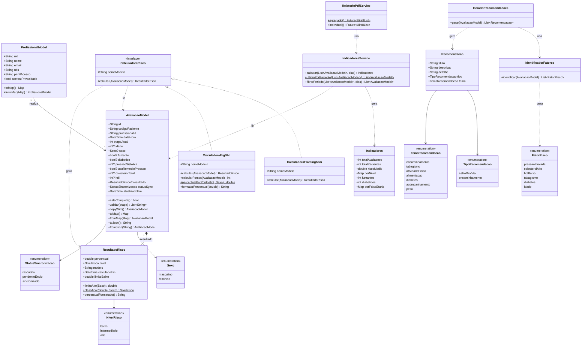
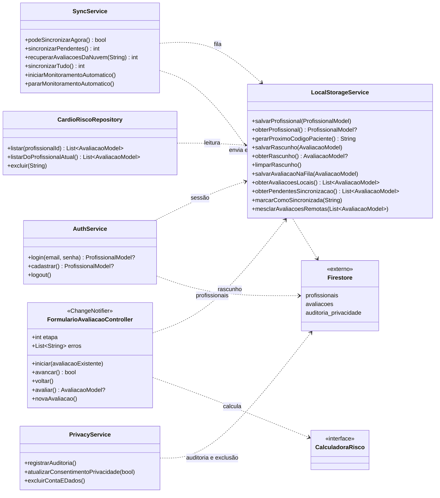

# Diagrama de Classes — CardioRisco

Este documento apresenta as classes do CardioRisco como elas estão **implementadas no código** da Unidade II: atributos, métodos principais e relacionamentos.

O app segue a arquitetura em camadas pedida no aditivo do estudo de caso:

- **Domain** (`lib/domain/`): modelos e regras de negócio (cálculo do risco, fatores, recomendações e indicadores). Não depende de Flutter nem do Firebase.
- **Data** (`lib/data/`): onde os dados são guardados e enviados (aparelho e Firebase).
- **Presentation** (`lib/presentation/`): as telas e os controladores de estado (Provider).

---

## 1. Diagrama do domínio (modelos e regras)

---

## 2. Diagrama das camadas Data e Presentation

Mostra quem guarda, envia e lê as avaliações. As setas indicam "usa".

---

## 3. Descrição das classes

### Domain

| Classe | O que representa | Principais responsabilidades |
|---|---|---|
| `ProfissionalModel` | Profissional que usa o app (ACS ou equipe de saúde) | Guardar o perfil vindo do Firebase Authentication e do Firestore. O `perfilAcesso` define o que cada um pode ver |
| `AvaliacaoModel` | Uma avaliação feita numa visita | Guardar as 7 respostas, a etapa em que o formulário parou, o resultado e o status de envio. Validar os dados (`validar`, por etapa ou completo) |
| `ResultadoRisco` | O resultado de um cálculo | Guardar o percentual em 10 anos, o nível e o modelo usado. Classificar o percentual pelas faixas da SBC |
| `CalculadoraRisco` | Contrato comum dos modelos de cálculo (interface) | Permitir vários modelos sem mudar o resto do app |
| `CalculadoraFramingham` | Equação de Framingham (D'Agostino, 2008) | Calcular o percentual exato. É o modelo do velocímetro |
| `CalculadoraErgSbc` | Escore de Risco Global da SBC pela tabela de pontos | Somar os pontos de cada resposta e converter no percentual da tabela. Mostrado na Tela 3 para comparação |
| `IdentificadorFatores` | Regra dos fatores de risco | Dizer quais respostas estão alteradas (pressão, colesterol, HDL, fumo, diabetes, idade) |
| `GeradorRecomendacoes` | Regras de orientação | Gerar o encaminhamento conforme o nível e as recomendações de estilo de vida conforme as respostas ("Parar de fumar" só para fumantes) |
| `Recomendacao` | Uma orientação da Tela 4 | Guardar título, descrição curta, explicação, tipo e tema |
| `IndicadoresService` / `Indicadores` | Indicadores agregados (dashboard e relatórios) | Contar cada paciente uma vez pela avaliação mais recente, filtrar por período e calcular médias, sem identificar pacientes |
| `RelatorioPdfService` | Relatórios em PDF | Gerar o relatório agregado e o individual de uma avaliação |

### Data e Presentation

| Classe | Camada | Principais responsabilidades |
|---|---|---|
| `LocalStorageService` | Data | Guardar no aparelho: perfil, código do paciente, rascunho e fila de avaliações |
| `SyncService` | Data | Enviar a fila ao Firestore só no Wi-Fi, recuperar as avaliações da nuvem e juntar sem duplicar |
| `AuthService` | Data | Login, cadastro e saída da conta (Firebase Authentication) |
| `PrivacyService` | Data | Consentimento, registro de auditoria de privacidade e exclusão definitiva dos dados |
| `CardioRiscoRepository` | Data | Ler as avaliações do profissional para o histórico e excluir do aparelho |
| `FormularioAvaliacaoController` | Presentation | Estado do formulário em etapas (Provider), salvamento automático do rascunho e modo edição |

**Por que não existe uma classe `Paciente`:** o paciente é identificado **só pelo código** (`codigoPaciente`, ex.: P-0001), dentro da própria avaliação, sem nome nem CPF. O histórico, a comparação e a evolução agrupam as avaliações pelo código.

---

## 4. Relacionamentos

- **ProfissionalModel → AvaliacaoModel (1 para muitos):** um profissional realiza várias avaliações (ligadas pelo `profissionalId`). O ACS vê só as dele.
- **AvaliacaoModel ◆ ResultadoRisco (composição):** o resultado faz parte da avaliação e só existe depois do cálculo.
- **CalculadoraRisco ◁ CalculadoraFramingham e CalculadoraErgSbc:** os dois modelos seguem o mesmo contrato, como pede o aditivo ("múltiplos modelos de estratificação de risco").
- **GeradorRecomendacoes → IdentificadorFatores:** as recomendações usam os mesmos fatores mostrados na Tela 3, para a Tela 3 e a Tela 4 nunca se contradizerem.
- **SyncService → LocalStorageService:** a sincronização lê a fila do aparelho e marca o que foi enviado.

---

## 5. Regras de negócio representadas

**Classificação do risco** (`ResultadoRisco.classificar`, Escore de Risco Global da SBC)

| Nível | Homens | Mulheres |
|---|---|---|
| Baixo | menor que 5% | menor que 5% |
| Intermediário | de 5% a 20% | de 5% a 10% |
| Alto | maior que 20% | maior que 10% |

**Validações clínicas** (`AvaliacaoModel.validar`)

| Campo | Faixa aceita |
|---|---|
| Idade | 30 a 74 anos (faixa em que o escore é válido) |
| Pressão arterial sistólica | 70 a 250 mmHg |
| Colesterol total | 70 a 500 mg/dL |
| HDL | 10 a 150 mg/dL, e menor que o colesterol total |

**Fatores de risco** (`IdentificadorFatores`): pressão sistólica ≥ 140 mmHg ou uso de remédio; colesterol total ≥ 190 mg/dL; HDL < 40 mg/dL; fumo; diabetes; idade ≥ 45 anos (homens) ou ≥ 55 anos (mulheres).

**Funcionamento offline e salvamento automático** (`statusSync`)
- `rascunho`: formulário em andamento, salvo automaticamente no aparelho (e retomado na `etapaAtual`).
- `pendenteEnvio`: avaliação concluída, na fila do aparelho, esperando Wi-Fi.
- `sincronizado`: já enviada ao Firestore.

**Privacidade:** a avaliação guarda só o código do paciente, nunca nome ou CPF.

---

## 6. Mudanças em relação à primeira versão (18/11/2026)

A primeira versão foi desenhada antes da programação. Na implementação, os nomes e algumas classes mudaram:

| Antes | Agora | Motivo |
|---|---|---|
| `Usuario` | `ProfissionalModel` | Nome usado no código do login (Firebase) |
| `Avaliacao` | `AvaliacaoModel` | Padrão de nomes dos modelos do projeto |
| `StatusAvaliacao` / `status` | `StatusSincronizacao` / `statusSync` | Deixa claro que o status é do envio ao Firebase |
| `Paciente` | (removida) | O paciente é só o `codigoPaciente` dentro da avaliação |
| `RegistroAuditoria` | `PrivacyService.registrarAuditoria` | A auditoria foi feita como registro no Firestore (`auditoria_privacidade`), sem classe própria |
| — | `etapaAtual` em `AvaliacaoModel` | Retomar o rascunho na etapa em que parou |
| — | `FatorRisco`, `IdentificadorFatores`, `TemaRecomendacao` | Fatores da Tela 3 e ícones/cores das recomendações da Tela 4 |
| — | `Indicadores`, `IndicadoresService`, `RelatorioPdfService` | Dashboard e relatórios (parte do Erick) |

---

## 7. Relação com outros documentos

- Telas: `docs/prototipoAltaFidelidadeUnidade2.pdf`.
- Fluxo de navegação: `docs/fluxodeNavegacao.md`. Casos de uso: `docs/diagramaCasodeUso.md`.
- Como as classes são guardadas no Firestore (coleções e documentos): documento de modelagem do banco de dados.
- Fontes do cálculo: `docs/pesquisa.md`.
