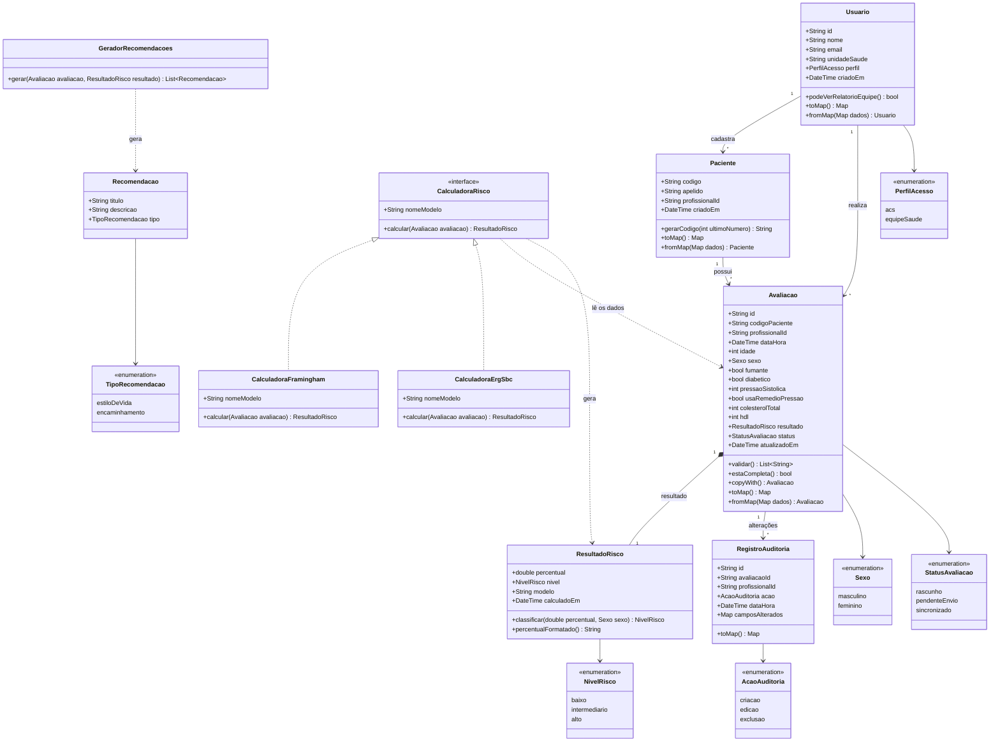

# Diagrama de Classes — CardioRisco

Este documento apresenta os **modelos de domínio** do CardioRisco: as principais classes do aplicativo, seus atributos, métodos e relacionamentos.

Essas classes ficam na camada **Domain** da arquitetura em camadas (Presentation, Domain e Data) pedida no aditivo do estudo de caso. A camada **Data** usa essas classes para salvar no aparelho e no Firestore. A camada **Presentation** usa as classes para montar as telas.

---

## 1. Diagrama

---

## 2. Descrição das classes

| Classe | O que representa | Principais responsabilidades |
|---|---|---|
| `Usuario` | Profissional de saúde que usa o app (ACS ou equipe de saúde) | Guardar os dados do login no Firebase Authentication e definir o que cada perfil pode ver |
| `Paciente` | Pessoa avaliada, identificada **só por código** (ex.: P-0013) | Gerar o código automaticamente e agrupar as avaliações para o histórico e a evolução. **Não guarda nome nem CPF** |
| `Avaliacao` | Uma avaliação feita numa visita domiciliar | Guardar as 7 respostas do formulário, validar os dados, guardar o resultado e o status de envio |
| `ResultadoRisco` | O resultado do cálculo | Guardar o percentual em 10 anos, o nível de risco e o modelo usado |
| `CalculadoraRisco` | Contrato comum dos modelos de cálculo (interface) | Permitir vários modelos de estratificação sem mudar o resto do app |
| `CalculadoraFramingham` | Cálculo pela equação de Framingham (D'Agostino, 2008) | Calcular o percentual de risco a partir da avaliação |
| `CalculadoraErgSbc` | Cálculo pelo Escore de Risco Global da SBC (tabela de pontos) | Calcular o percentual de risco pela tabela de pontos da SBC |
| `GeradorRecomendacoes` | Regras de orientação | Gerar recomendações personalizadas conforme o nível de risco e as respostas (ex.: "Pare de fumar" só para fumantes) |
| `Recomendacao` | Uma orientação mostrada na Tela 4 | Guardar o título, a descrição e se é de estilo de vida ou de encaminhamento |
| `RegistroAuditoria` | Histórico de alterações de uma avaliação | Registrar quem criou, editou ou excluiu, quando e o que mudou |

---

## 3. Relacionamentos

- **Usuario → Paciente (1 para muitos):** um profissional cadastra vários pacientes.
- **Usuario → Avaliacao (1 para muitos):** um profissional realiza várias avaliações. Pelo controle de acesso, o ACS vê só as avaliações que ele mesmo fez.
- **Paciente → Avaliacao (1 para muitos):** um paciente pode ter várias avaliações ao longo do tempo. É isso que permite o histórico, a comparação e o gráfico de evolução.
- **Avaliacao ◆ ResultadoRisco (composição):** o resultado faz parte da avaliação e não existe sem ela.
- **Avaliacao → RegistroAuditoria (1 para muitos):** cada criação, edição ou exclusão gera um registro.
- **CalculadoraRisco ◁ CalculadoraFramingham e CalculadoraErgSbc:** as duas calculadoras seguem o mesmo contrato. Assim o app pode trocar ou comparar modelos de cálculo, como pede o aditivo ("múltiplos modelos de estratificação de risco").

---

## 4. Regras de negócio representadas

**Privacidade**
- `Paciente` não tem nome nem CPF, só o código gerado pelo app e um apelido opcional.

**Classificação do risco** (método `ResultadoRisco.classificar`, conforme o Escore de Risco Global da SBC)

| Nível | Homens | Mulheres |
|---|---|---|
| Baixo | menor que 5% | menor que 5% |
| Intermediário | de 5% a 20% | de 5% a 10% |
| Alto | maior que 20% | maior que 10% |

**Validações clínicas** (método `Avaliacao.validar`, para impedir valores impossíveis ou fora da faixa do escore)

| Campo | Faixa aceita |
|---|---|
| Idade | 30 a 74 anos (faixa em que o escore é válido) |
| Pressão arterial sistólica | 70 a 250 mmHg |
| Colesterol total | 70 a 500 mg/dL |
| HDL | 10 a 150 mg/dL, e menor que o colesterol total |

**Funcionamento offline e salvamento automático** (atributo `status`)
- `rascunho`: formulário em andamento, salvo automaticamente no aparelho.
- `pendenteEnvio`: avaliação concluída, guardada na fila local, esperando Wi-Fi.
- `sincronizado`: já enviada ao Firestore.

---

## 5. Relação com outros documentos

- O formulário de 7 perguntas e as telas estão no protótipo `docs/prototipoAltaFidelidadeUnidade2.pdf`.
- A forma como essas classes são guardadas no Firestore (coleções e documentos) fica no documento de modelagem do banco de dados.
