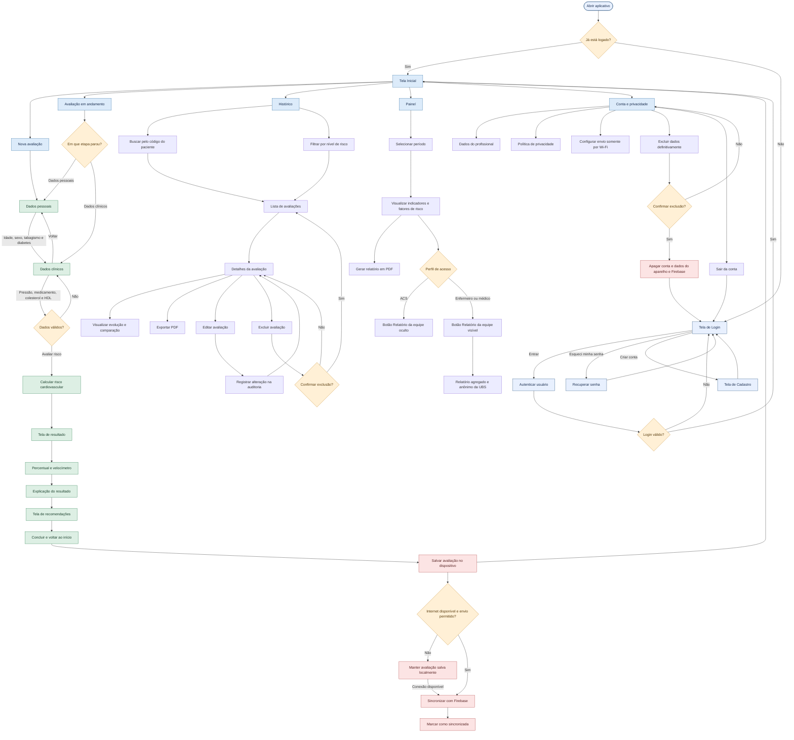

# Fluxo de Navegação — CardioRisco

Este documento apresenta o **fluxo de navegação do CardioRisco**, descrevendo como o usuário percorre as telas do aplicativo, quais decisões o sistema toma ao longo do caminho e em que momentos os dados são salvos e sincronizados.

O fluxo parte da **abertura do aplicativo**, que verifica se o usuário já está logado (o login só é pedido no primeiro acesso). Em seguida passa pela **Tela Inicial** (ponto central de navegação) e se ramifica em cinco áreas: nova avaliação, avaliação em andamento, histórico, painel e conta e privacidade.

---

## 1. Diagrama

**Observação:** as formas em losango representam decisões; os retângulos representam telas ou ações do sistema. As cores agrupam o fluxo por área: acesso (azul-escuro), navegação (azul-claro), avaliação (verde), decisões (amarelo) e armazenamento/dados (vermelho).

---

## 2. Acesso ao aplicativo

O login é exigido **apenas no primeiro acesso** (ou depois de sair da conta). Nas demais aberturas, o aplicativo reconhece a sessão e leva direto à Tela Inicial.

| Origem | Ação | Destino |
|---|---|---|
| Abrir aplicativo | Iniciar o app | **Já está logado?** |
| Já está logado? | Sim | Tela Inicial |
| Já está logado? | Não | Tela de Login |
| Tela de Login | Entrar | Autenticar usuário → **Login válido?** |
| Login válido? | Sim | Tela Inicial |
| Login válido? | Não | Retorna à Tela de Login |
| Tela de Login | Esqueci minha senha | Recuperar senha → retorna ao Login |
| Tela de Login | Criar conta | Tela de Cadastro → retorna ao Login |

---

## 3. Tela Inicial

A Tela Inicial é o **hub de navegação** do aplicativo. A partir dela o usuário acessa:

| Destino | Finalidade |
|---|---|
| Nova avaliação | Iniciar uma avaliação cardiovascular do zero |
| Avaliação em andamento | Retomar uma avaliação iniciada e não concluída, **na etapa em que parou** |
| Histórico | Consultar, buscar, editar e excluir avaliações anteriores |
| Painel | Visualizar indicadores e relatórios por período |
| Conta e privacidade | Gerenciar dados do profissional, privacidade e saída da conta |

---

## 4. Fluxo de avaliação

1. **Nova avaliação** leva à tela de **Dados pessoais**.
2. **Avaliação em andamento** abre a decisão **Em que etapa parou?** e retorna o usuário à etapa correspondente:
   - **Dados pessoais:** retoma na tela de Dados pessoais.
   - **Dados clínicos:** retoma diretamente na tela de Dados clínicos, com o que já foi preenchido.
3. **Dados pessoais:** idade, sexo, tabagismo e diabetes.
4. **Dados clínicos:** pressão, medicamento, colesterol e HDL. Há opção de **Voltar** para os dados pessoais.
5. **Dados válidos?**
   - **Não:** o usuário retorna aos dados clínicos para corrigir o preenchimento.
   - **Avaliar risco:** o fluxo segue para o cálculo.
6. **Calcular risco cardiovascular.**
7. **Tela de resultado**, que se desdobra em sequência:
   - Percentual e velocímetro
   - Explicação do resultado
   - Tela de recomendações
8. **Concluir e voltar ao início.**
9. **Salvar avaliação no dispositivo**, com retorno à Tela Inicial.

### Armazenamento e sincronização

Após salvar a avaliação no dispositivo, o sistema verifica: **Internet disponível e envio permitido?**

| Condição | Comportamento |
|---|---|
| **Sim** | Sincronizar com Firebase → Marcar como sincronizada |
| **Não** | Manter avaliação salva localmente; quando houver **conexão disponível**, sincronizar com Firebase → Marcar como sincronizada |

O envio respeita a configuração "Configurar envio somente por Wi-Fi", disponível em Conta e privacidade.

---

## 5. Histórico

| Etapa | Descrição |
|---|---|
| Histórico | Ponto de entrada, com duas formas de localizar avaliações |
| Buscar pelo código do paciente | Localiza avaliações por código (sem nome ou CPF) |
| Filtrar por nível de risco | Filtra por risco baixo, intermediário ou alto |
| Lista de avaliações | Exibe os resultados da busca ou do filtro |
| Detalhes da avaliação | Mostra os dados completos de uma avaliação |

A partir dos **Detalhes da avaliação**, o usuário pode:

- **Visualizar evolução e comparação** entre avaliações.
- **Exportar PDF** da avaliação.
- **Editar avaliação:** a alteração passa por **Registrar alteração na auditoria** e retorna aos detalhes.
- **Excluir avaliação:** abre **Confirmar exclusão?**
  - **Sim:** a avaliação é excluída e o usuário volta à Lista de avaliações.
  - **Não:** retorna aos Detalhes da avaliação.

---

## 6. Painel

1. **Painel** → **Selecionar período.**
2. **Visualizar indicadores e fatores de risco.**
3. A partir dos indicadores:
   - **Gerar relatório em PDF** (disponível para todos os perfis).
   - **Perfil de acesso**, que define se o botão **Relatório da equipe** aparece:

| Perfil | Resultado |
|---|---|
| **ACS** | Permanece no Painel, com todos os indicadores e o relatório em PDF; apenas o botão **Relatório da equipe** fica oculto |
| **Enfermeiro ou médico** | O botão **Relatório da equipe** fica visível e leva ao **Relatório agregado e anônimo da UBS** |

---

## 7. Conta e privacidade

| Opção | Comportamento |
|---|---|
| Dados do profissional | Exibe as informações do usuário logado |
| Política de privacidade | Exibe a política de privacidade do aplicativo |
| Configurar envio somente por Wi-Fi | Restringe a sincronização com o Firebase a redes Wi-Fi |
| Excluir dados definitivamente | Abre **Confirmar exclusão?** (Sim: **Apagar conta e dados do aparelho e Firebase** e retorna ao Login; Não: retorna a Conta e privacidade) |
| Sair da conta | Encerra a sessão e retorna à Tela de Login; o próximo acesso volta a exigir login |

---

## 8. Decisões do fluxo

| Decisão | Saídas |
|---|---|
| Já está logado? | Sim → Tela Inicial; Não → Tela de Login |
| Login válido? | Sim → Tela Inicial; Não → Tela de Login |
| Em que etapa parou? | Dados pessoais → Dados pessoais; Dados clínicos → Dados clínicos |
| Dados válidos? | Não → Dados clínicos; Avaliar risco → Calcular risco |
| Internet disponível e envio permitido? | Sim → Sincronizar com Firebase; Não → Manter avaliação salva localmente |
| Confirmar exclusão? (avaliação) | Sim → Lista de avaliações; Não → Detalhes da avaliação |
| Confirmar exclusão? (conta e dados) | Sim → Apagar conta e dados; Não → Conta e privacidade |
| Perfil de acesso | ACS → botão Relatório da equipe oculto; Enfermeiro ou médico → botão visível → Relatório agregado da UBS |

---

## 9. Relação com outros documentos

- O **Diagrama de Caso de Uso — CardioRisco** identifica os atores e as funcionalidades; este fluxo mostra **em que ordem e por quais telas** essas funcionalidades são acessadas.
- O **Protótipo de Alta Fidelidade** representa visualmente as telas citadas neste fluxo.
- O **Diagrama de Classes** e a **Modelagem do Banco de Dados** detalham como as avaliações, a auditoria e a sincronização com o Firebase são estruturadas.
